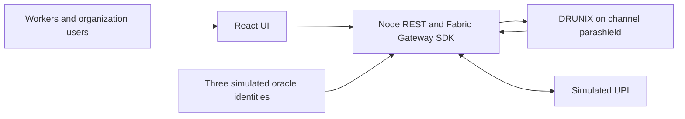

# ParaShield

ParaShield is a parametric income-protection application for Zomato and Swiggy
delivery partners in India. It uses React, a Node Fabric Gateway service,
and Go smart contracts on NPCI's DRUNIX sample network.

ParaShield builds on the [earlier ZyroSafe prototype](ZYROSAFE_DEPLOYMENT.md).

The local network uses sample Fabric identities, synthetic oracle inputs and simulated UPI transfers. DRUNIX commits
coverage, signed oracle readings, eligibility decisions, weekly caps and
settlement transitions.



## Prerequisites

Use a dedicated Docker environment. The upstream sample uses fixed container
names and its teardown removes sample chaincode containers, images and ledger
volumes.

| Tool | Verified version |
| --- | --- |
| OS | Ubuntu 26.04.1 on WSL2 x86-64 |
| Docker Engine and Compose | 29.9.3 and v5.7.0 with both `docker compose` and `docker-compose` available |
| Node and npm | 20.20.2 and 10.8.2 |
| Go | 1.26.8. The pinned DRUNIX source requires Go 1.26.1 or later. |
| Git, GNU Make, jq and OpenSSL | 2.53.0, 4.4.1, 1.8.1 and 3.5.5 |

The launcher uses DRUNIX revision `8090e0ce58802c8a0f13d23a6abe5a2d35456cc5`.
It uses `~/drunix` as the source if that revision is available there. Otherwise
it clones the upstream repository. The writable runtime and credentials live
outside ParaShield.

## Quickstart

From a fresh ParaShield checkout, run this command in the repository root.

```bash
scripts/dev-up.sh
```

`scripts/demo-up.sh` forwards to the same launcher for compatibility. The previous state variable remains accepted as an alias for `PARASHIELD_RUNTIME_STATE`. See the [runbook](docs/RUNBOOK.md) for startup and network reset recovery.


The command builds the DRUNIX binaries, installs pinned application
dependencies, starts the sample, deploys chaincode, runs a ledger smoke test,
and starts the API, simulator, mock UPI and frontend. Open
http://127.0.0.1:5173. Health and ledger readiness are available at
`http://127.0.0.1:8080/health` and `http://127.0.0.1:8080/ready`.

The launcher prints the writable DRUNIX runtime and external application state
paths. Workers can create their own account from the sign-in page. Staff
accounts require interactive provisioning. Use the account database in the
external application state directory printed by the launcher.

```bash
export PARASHIELD_ACCOUNT_DB=/path/to/external-state/ledger-data/gateway/accounts.sqlite
scripts/provision-user.sh insurer evaluation-insurer
scripts/provision-user.sh regulator evaluation-regulator
scripts/provision-user.sh platform evaluation-platform zomato
scripts/provision-user.sh admin evaluation-admin
```

Staff set up an authenticator on first sign-in. Keep recovery codes private.
Set the same `PARASHIELD_PASSWORD_PEPPER` for the launcher and provisioning
command if you configure a pepper. See [authentication details](docs/SECURITY.md).

## Evaluation walkthrough

Open [ParaShield](http://127.0.0.1:5173) in three separate browser profiles to keep the sessions independent. Each staff evaluator signs in using an account provisioned above and sets up an authenticator on first use. Send the passwords and recovery instructions privately.

| Profile | Steps | Evidence |
| --- | --- | --- |
| Worker | Choose **Create account**, choose Zomato, then sign in. Open **Set up coverage**, select the zone and plan, and activate with the simulated premium. | The activation receipt includes the policy ID, ledger transaction ID and block. The worker workspace lists payouts and opens **Ledger proof** on a recorded payout. |
| Insurer | Sign in and open **Insurer console**. Choose an unused zone for the current hour and select **One oracle offline**. Click **Run storm simulation**. | A declared event requires two signed readings. **Surge results** displays recorded 32-, 200- and 1,000-policy measurements. |
| Regulator | Sign in and open **Ledger audit**. Select the insurer's zone and the current IST week. | Inspect the event, quorum and weekly payout aggregates. Open `/insurer` to verify role denial. |

A signed event declaration alone does not make a worker eligible for payment. The ledger also requires an active policy, an eligible platform activity attestation, the configured waiting period, and a closed event window. For a timed evaluation on a dedicated sample, use the signed one-policy verification run in the [evaluation walkthrough](docs/EVALUATION.md#prepare-a-settled-evaluation-record) and inspect its recorded payout in the worker workspace. The run uses synthetic readings and simulated payment.

Platform staff can open **Platform workspace** to confirm the directory contains only accounts from their platform and record a completed work interval in IST. Admin staff can open **Admin workspace** to provision staff accounts, change staff roles, revoke another account's sessions, or issue a single-use password reset code.

## Configuration

Set values as process environment variables. Vite and the application
services ignore dotenv files. The tracked examples contain placeholders
and document the stand-alone service interfaces.

| Variable | Purpose and default |
| --- | --- |
| `DRUNIX_RUNTIME` | Writable checkout outside ParaShield. The quickstart makes one in `/tmp` when omitted. |
| `PARASHIELD_RUNTIME_STATE` | External directory for sample identities, local keys and durable job/UPI state. The launcher makes one in `/tmp` when omitted. Reuse it with the same ledger. |
| `PARASHIELD_WEB_PORT`, `PARASHIELD_GATEWAY_PORT` | Loopback ports 5173 and 8080. |
| `PARASHIELD_ORACLE_PORT`, `PARASHIELD_UPI_PORT` | Loopback ports 8081 and 8082. |
| `PARASHIELD_UPI_LATENCY_MS`, `PARASHIELD_UPI_FAILURE_BPS` | Simulated delay and failure probability in basis points. Defaults are 100 ms and zero. |
| `PARASHIELD_BENCHMARK_REPORT` | JSON read by the benchmark API. The quickstart uses the measured report in `docs/`. |
| `VITE_GATEWAY_URL` | Browser API base URL. Defaults to `http://127.0.0.1:8080`. |

## Verify

Run from the repository root after quickstart has installed packages. Export
the running `DRUNIX_RUNTIME` for the network and integration commands.

```bash
npm test
npm run lint
npm run typecheck
npm run build
(cd chaincode && go vet ./... && go test ./... -cover)
npm --prefix gateway test
npm --prefix mock-upi test
scripts/smoke-test.sh
scripts/gateway-integration.sh
scripts/services-integration.sh
```

To benchmark the same running sample, export `DRUNIX_RUNTIME` and
`PARASHIELD_RUNTIME_STATE` from the launcher and run `scripts/surge-test 32`.
Without an argument the script requests 1,000 policies. Use a dedicated
sample with simulated payment failures disabled. The runner temporarily
enables the signed test-window closure, creates synthetic policy records,
and writes measured reports. See [benchmark results](docs/BENCHMARKS.md).

## Troubleshooting

- If Docker is unreachable, start the Docker daemon and verify
  `docker info`. If `docker-compose` is missing, install the Compose CLI
  compatibility command expected by the upstream Yugabyte sample.
- If fixed container names are already in use, stop your previous sample
  with its own runtime and `scripts/network-down.sh`, or supply that
  running runtime to the quickstart.
- For a failed chaincode package install, check Docker access to
  `npcioss/drunix-ccenv:1.0` and `npcioss/drunix-baseos:1.0`. The deploy
  wrapper pulls those images if absent.
- Use a new runtime state directory after recreating the sample's MSPs and
  ledger. Old certificates and event cursors belong to the previous network.
- For an empty claim timeline, confirm premium, waiting period, the
  platform activity window, quorum and window closure. The browser
  exposes gateway errors and supports retry with the same operation ID.

## Implementation notes

The verified sample uses two organizations, two Lite Peers, two Committing
Peers, YugabyteDB, KeyDB, stateless validation services and a Raft orderer.
Independent bank and oracle MSPs and Falcon were not exercised.

- [Architecture](docs/ARCHITECTURE.md)
- [Quality checks and screenshots](docs/QUALITY.md)
- [Real and simulated behavior](docs/REAL_VS_SIMULATED.md)
- [Threat model](docs/THREAT_MODEL.md) and [edge-case verification](docs/EDGE_CASES.md)
- [Progress](PROGRESS.md), [decisions](DECISIONS.md), and [attributions](ATTRIBUTIONS.md)
