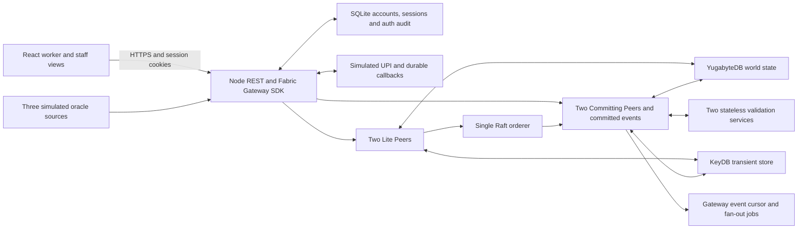

# Architecture

The validated deployment uses DRUNIX revision
`8090e0ce58802c8a0f13d23a6abe5a2d35456cc5`, channel `parashield`, and
chaincode `parashield` version 3.1. The deployment scripts use the upstream
sample lifecycle. [DRUNIX architecture](https://github.com/npci/drunix/blob/8090e0ce58802c8a0f13d23a6abe5a2d35456cc5/docs/drunix-arch.md)

## Network elements

| Element | Verified use |
| --- | --- |
| Lite Peers | Two sample Lite Peers executed enrollment, oracle quorum, payout and settlement endorsements. |
| Committing Peers | Both sample committing peers validated and committed blocks. The gateway's event stream subscribes to a committing peer. |
| Stateless validation service | The sample ran one validation-service container per peer organization as part of commit validation. Independent capacity was not benchmarked. |
| Raft | The sample ran one Raft orderer. No failover experiment was run. |
| YugabyteDB | The sample's SQL world state was exercised. Chaincode uses point lookups and composite indexes. It does not require CouchDB rich queries. |
| KeyDB | The sample runs shared transient stores. Enrollment writes to `workerPII` via the real transient/private-data flow. No independent KeyDB performance measurement was run. |
| Falcon | Not used. Deployment used the upstream Docker sample. |
| Four organizations | Not exercised. The verified topology has two MSPs. |

Org1MSP hosts the simulated insurer, bank, and regulator certificates.
Org2MSP hosts the simulated Zomato and Swiggy platform certificates and
three distinct oracle certificates. The worker signs into the API and is
mapped to an authorized policy and platform actor. Chaincode checks the
certificate attributes `role`, `platformId`, and `oracleId`. The sample
chaincode and private collection endorsement require **both sample MSPs**.
Independent bank and oracle MSP endorsements remain an integration gap.

## Data and processing

- The gateway owns the external SQLite account database. It stores Argon2id
  password hashes, hashed session tokens, encrypted TOTP secrets, encrypted
  onboarding drafts and authentication audit records. Browser requests carry
  an HttpOnly session cookie and a CSRF token for mutations. The gateway
  confirms the account role before choosing a Fabric identity.

- Private worker inputs are sent as transient proposal data into
  `workerPII`. Public state stores a salted hash, an opaque worker ID and
  policy terms. The sample collection admits both peer MSPs. Its member
  organizations can hold the private data as part of the Fabric trust model.
- The ledger starts coverage on bank-confirmed premium. A platform
  attestation must overlap the event hour. Epoch seconds come from Fabric's
  transaction timestamp. Integer compensation uses paise.
- Independent oracle certificates submit one reading per trigger and UTC
  hour. The first qualifying quorum freezes the declaration. A separate
  reading key can record a late reading without altering the declaration.
- Reservation selects the highest eligible overlapping compensation and
  updates the worker-hour lock and policy-week cap in the same transaction.
  The IST week uses the event bucket's start. Reservation and finalization
  have separate transactions and events. A failed settlement releases its
  reservation.
- The gateway checkpoints committed events before doing work. Policy pages
  are processed in bounded batches. The mock UPI service records each
  reference before calling back, and restarts can resume pending delivery.
  Each service instance needs its own state directory, with a single mock
  UPI writer for that directory.
- The default window waits for potentially competing readings. The
  benchmark's insurer-enabled **SIMULATED** early close requires every
  registered oracle to sign completion. It cannot close with an offline
  oracle. All observed measurements used real clock and ledger commits.
